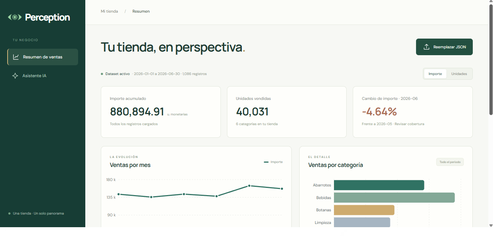
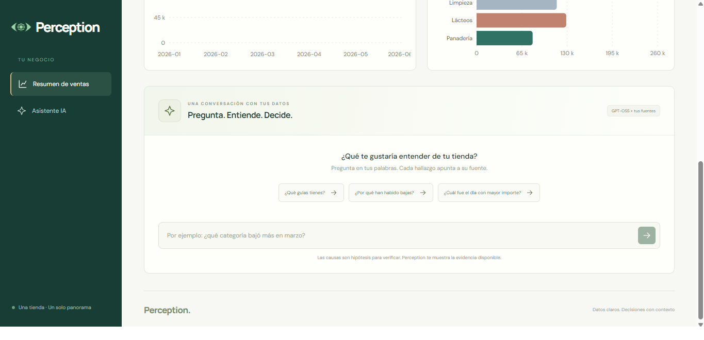

## Arranque local desde Windows (PowerShell)

Desde la raíz, con Python 3.11++:

```powershell
python -m venv .venv
.\.venv\Scripts\python.exe -m pip install -r Backend/requirements.txt
Copy-Item Backend/.env.example Backend/.env
Agregar la API KEY de Groq

.\.venv\Scripts\python.exe -m Backend.scripts.prepare_embeddings
.\.venv\Scripts\python.exe -m uvicorn Backend.main:app --reload
```

En otra terminal:

```powershell
cd Frontend
npm install
npm run dev
```

Abrir `http://127.0.0.1:5173` en el navegador para acceder a la UI de la aplicación.

El asisten de chat emplea Groq con el modelo `openai/gpt-oss-120b`.

## Datos

`POST /datasets`, Content-Type `application/json`, recibe un json. Cada registro contiene `fecha` ISO `YYYY-MM-DD`, `categoria` no vacía, `unidades` entero no negativo e `importe` numérico finito no negativo. No acepta campos adicionales ni cadenas numéricas. Tiene como límites: 100.000 registros, 60 meses y 30 categorías para acotar el contexto del modelo.

Una carga válida reemplaza `Backend/data/dataset.json`. Si no es válido, se mantiene la versión anterior. Las métricas se recalculan al iniciar la aplicación.

`GET /datasets/current` restaura las gráficas al recargar el navegador; devuelve 409 si no hay dataset.

## Métricas

Importe y unidades por mes, categoría, categoría/mes y día de semana; variaciones mensuales; diferencias absolutas por categoría; serie mensual como tendencia; tres mayores importes diarios como picos. Los días de semana incluyen promedio por día observado.

## Chat y RAG

`POST /chat` recibe `{"question":"¿Por qué cayó marzo?","stream":false}` y devuelve `answer` markdown y `sources`. Cada métrica y sección tiene un ID; las citas son enlaces `#ID`. Un token ausente produce 503; un fallo del proveedor, 502. No se simulan respuestas del modelo cuando falta la conexión.

El índice de Chroma se reconstruye al iniciar desde `Backend/knowledge/*.md`. Cada encabezado `##` delimita un fragmento, con ID estable derivado de archivo y título (los títulos deben ser únicos por archivo). Sentence Transformers multilingüe calcula embeddings normalizados; se entregan explícitamente en `add` y `query`, con `embedding_function=None`. Se recuperan hasta tres fragmentos con distancia ≤ 0.8.

La consulta combina pregunta y patrones detectados por pandas. El prompt siempre incluye todas las métricas precalculadas, sus fuentes y las limitaciones. 

## Comprobaciones adicionales

El prompt conserva todas las métricas y sus IDs de fuente en una representación compacta por columnas (`campos` y `filas`), evitando repetir nombres de campos en cada registro agregado. Las fuentes de la interfaz conservan su formato completo. Esto reduce tokens, pero no elimina los límites de solicitudes y tokens de la cuenta de Groq. Si Groq devuelve `retry-after`, el chat muestra el tiempo de espera; una solicitud demasiado grande se informa por separado.

```powershell
.\.venv\Scripts\python.exe -m Backend.tests.smoke_rag
```

El último comando prueba Sentence Transformers y Chroma reales usando la carpeta local previamente preparada. Las pruebas normales usan un doble del modelo para verificar el contrato sin gastar cuota; hace falta `GROQ_API_KEY` válida para comprobar calidad, latencia y streaming del proveedor real.

```powershell
.\.venv\Scripts\python.exe -m pytest Backend/tests -q --basetemp=.test-tmp
```



